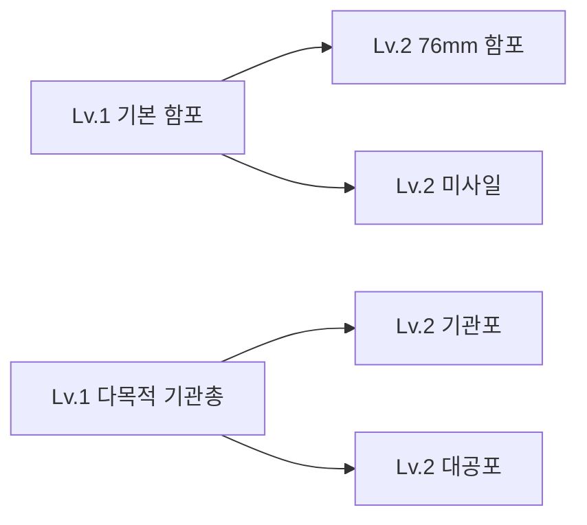
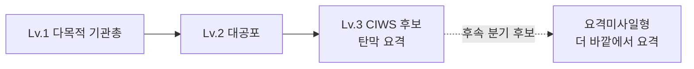

# 블록 분기 진화 도입 계획

작성일: 2026-10-27 · 현황 확인: 2026-10-28  
상태: **검토용 설계안**. 1단계 두 모델은 제작됐으나 무장 데이터·사격·카드·전직 시스템은 아직 연결되지 않았다. 아래 카드 확률·보장 및 3레벨 경로는 제안이며 적용된 규칙이 아니다.

최신 사용자 제안: **기본 함포 → 76mm / 미사일**, **다목적 기관총 → 기관포 / 대공포**. 아래 두 기본형·네 분기가 이전의 기관포 하나에서 세 갈래로 나누던 안을 대체한다. 미사일의 세부 성격과 3레벨 종착점은 논의용 제안으로 남긴다.

## 1. 제안

**블록 획득과 분기 진화를 함께 유지한다. 1레벨은 기본형, 2레벨은 역할 선택, 3레벨은 선택한 역할의 완성형으로 만든다.**

새 블록 획득은 함선을 넓히는 선택, 진화는 같은 자리에 투자해 역할을 바꾸는 선택이다. 기본 함포와 다목적 기관총을 각각 설치하고, 같은 기본형 두 문을 서로 다른 계열로 키울 수 있다.

첫 시험은 두 기본형과 2레벨 분기 네 가지로 한정한다. 각 기본형에서 두 갈래 중 하나를 고른다. 3레벨은 해당 역할을 완성하는 안을 제안하되, 구체적인 무기와 추가 분기 여부는 미확정이다.

### 현재 작업 현황

| 항목 | 확인된 상태 |
| --- | --- |
| 1레벨 기본 함포·다목적 기관총 | `ArtSource/StarterWeapons_v1`에 Blender 원본·FBX·Unity 시각 프리팹·검토 씬·캡처 제작. 660 / 696 tris, 임시 Unity 프로젝트의 크기·재질·조준축 검사 통과 |
| 1레벨 인게임 무장 | **미연결**: 두 시각 프리팹은 `ModuleDefinition`, 사격 런타임, 시작 배치·설치 카드에 등록되지 않음 |
| 2레벨 76mm·기관포 | 기존 모델·무장 런타임 있음. 새 전직 트리의 노드로 연결되지는 않음 |
| 2레벨 미사일·대공포 | 기존 VLS·유도로켓·SAM·CIWS 등 재사용 후보는 있으나 어떤 정의·외형을 쓸지와 역할 조정은 **미확정** |
| 분기 선택·상태 전환·저장 | **미구현**. 현행 `ApplyUpgrade()`는 기존 정의 안에서 강화 단계만 증가. `RunSave`는 정의 ID와 강화 단계를 저장 |
| 테스트 | 1레벨 모델의 임포트·시각 프리팹·기존 조준 코드 검증만 확인. 네 갈래 전직·실전 밸런스 검증은 아직 없음 |

## 2. 현재 구조에서 달라지는 점

| 항목 | 현재 확인한 구조 | 제안 |
| --- | --- | --- |
| 블록 단계 | 표시 1~3레벨, 내부 강화 단계 0~2 | 표시 1~3레벨 유지, 2레벨 진입 때 분기 선택 |
| 강화 | 같은 ModuleDefinition에 수치 배율과 단계별 외형 적용 | 계열 선택 시 실제 무기 정의·런타임 전환, 이후 계열 내 강화 |
| 정비 카드 | 설치 / 장비 강화 / 성장 / 편대 카드 | 장비 강화 카드를 무장에 한해 진화 선택으로 확장 |
| 기존 강화 조작 | 카드 선택 → 함선 위 강화 대상 클릭 → 즉시 적용 | 카드 선택 → 대상 클릭 → 진화 방향 비교 → 확정 |
| 신규 무기 | 40mm 쌍열포·76mm 함포·CIWS 등을 각각 설치 카드로 획득 | 시험 범위에서 두 기본형과 전직 결과의 설치 카드 중복 여부를 결정 |
| 저장 | 정의 ID·위치·회전·강화 단계·승강 여부 | 진화 노드 ID와 실효 정의도 저장, 기존 저장 마이그레이션 |

이 문서에서 말하는 분기 진화는 제안이다. 현재 코드에는 선택한 전직에 맞춰 무기 동작을 교체하는 기능이 없다.

## 3. 첫 진화 트리: 두 기본형과 네 갈래

| 분기 | 전투에서 달라지는 것 | 주력 표적 | 약점·비용 | 재사용할 현재 무기 |
| --- | --- | --- | --- | --- |
| 76mm 함포 | 포탄·파편을 반복 발사 | 수상함·밀집 선박 | 최소 사거리, 근접 대응 약화 | 76mm 함포(NavalGun) |
| 미사일 | 미사일 발사. 대함 특화는 제안이며 미확정 | 대함 특화라면 대형함·보스 | 탄 수·재장전 등은 미확정 | VLS·유도로켓 등 후보 비교 필요 |
| 기관포 | 빠른 근거리 사격 | 고속정·자폭정, 항공 보조 | 짧은 사거리, 대형함 대응 약화 | 기관포(Autocannon) |
| 대공포 | 항공 대응을 중심으로 하는 방어 계열 | 항공기·드론 | 수상 공격을 어느 정도 허용할지 미확정 | 기존 CIWS·40mm 쌍열포 기능 중 재사용 검토 |

**역할 중복은 검증이 필요하다.** 현재 40mm 쌍열포(옛 코드명 Nobong)는 항공기를 우선하면서 수상함도 공격하고, CIWS는 접근 미사일을 우선한다. 새 대공포가 이미 있는 쌍열포·CIWS와 어떻게 달라지는지는 아직 결정되지 않았다. 명칭만 바꾸어 기능이 구현된 것으로 취급하지 않는다.

**3레벨 후보(미확정)**: 76mm → 강화 76mm, 미사일 → 강화 대함미사일, 기관포 → 40mm 쌍열포, 대공포 → CIWS. 대공포 Lv.2에 제한적 미사일 요격을 주고 Lv.3에서 완성하는 것도 제안이다. 현재 쌍열포는 항공 우선이므로 기관포의 3레벨로 쓸 때 역할 조정 여부를 별도로 결정해야 한다.

전직으로 사라지는 장점도 비교 화면에 표시한다. 공격형만 고르면 근접 방어가 약해지고, 방어형에만 투자하면 수상함을 격침할 화력이 부족해질 수 있다.

## 4. 한 번의 정비에서 일어나는 일

1. 적 격침으로 함선 레벨업 → 기존 정비 화면이 열린다.
2. 설치·장비 개량·성장/편대 보상 중 하나를 고른다.
3. 장비 개량을 골랐다면 함선 위 대상 블록을 클릭한다.
4. Lv.1 기본 함포 또는 다목적 기관총이면 해당 기본형의 두 진화 방향을 동시에 비교한다. 선택하지 않은 방향을 랜덤으로 숨기지 않는 안이다.
5. 확정하면 같은 자리가 새 무기로 바뀌고 해당 정비의 보상을 사용한 것으로 처리한다.
6. Lv.2 무기를 고르면 해당 계열의 Lv.3 완성형으로 올린다.

**진화 1회는 기존 강화처럼 보상 1회를 소비한다.** 분기를 고르는 과정은 추가 비용이 없다. 별도 무기 경험치·킬 수·진화 재료는 첫 버전에 넣지 않는다. 방공·대잠 무기는 적 구성에 따라 킬을 못 얻을 수 있기 때문이다.

대상 선택과 분기 비교 중에는 취소하고 원래 카드로 돌아갈 수 있다. 확정 전에는 비용을 쓰지 않는다. 분기는 이번 출격 동안 고정하고, 재출격에서는 다시 선택한다. 초기 시험에서는 전직 초기화 기능을 두지 않는다.

Lv.3 무기는 장비 개량 대상으로 나오지 않는다. 같은 무기를 두 문 설치했다면 각 블록이 독립적으로 진화한다. 함선 전체가 같은 직업으로 바뀌는 방식은 아니다.

## 5. 블록 획득과 진화의 비중

### 권장 카드 운영

기존 카드 슬롯과 편대·보스 보상 규칙을 최대한 이용한다.

| 자리 | 운영 제안 |
| --- | --- |
| 1번 | 신규 블록 설치. 시험 대상은 기본 함포·다목적 기관총이며, 다른 계열의 설치 범위는 시험 설정에서 결정 |
| 2번 | 장비 개량 또는 기존 성장 카드. 초반 진화 체험과 장기간 미출현 방지 규칙 추가 |
| 3번 | 기존 자유 슬롯: 설치·개량·성장·편대. 편대 첫 합류 보장 유지 |
| 보스 | 기존 에픽 성장 보장 유지. 추가 무료 진화는 초기 시험에 넣지 않음 |

**아직 미적용인 제안:** 첫 두 번의 일반 레벨업 정비에서는 유효한 진화 대상이 있으면 2번에 장비 개량을 제시한다. 플레이어가 선택해야 실제로 진화하므로, 같은 기본형 한 문을 빠르게 Lv.3까지 키우거나 두 문을 서로 다른 Lv.2로 만들 수 있다.

그 이후는 현재 성장 슬롯의 강화 출현 비중(30~65%)을 출발점으로 삼는다. 유효 대상이 있는데 일반 정비 두 번 연속 개량 카드가 없었다면 다음 일반 정비에 보장한다. 이는 선택 강제가 아니라 기회 보장이다. 카드 재추첨은 정비 횟수로 세지 않고, 그 정비에서 최종 제시한 카드로 미출현 횟수를 갱신한다. 보스·훈련 정비는 이 횟수에서 제외한다.

초기 시험에서는 신규 설치와 진화의 자원 효율을 따로 측정한다. 진화가 너무 효율적이면 작은 함선에 최종 무기만 모으고, 너무 약하면 계속 새 블록만 붙인다. 두 방식 중 어느 쪽을 골라도 이유가 있어야 한다.

### 무기를 통합할 범위

- 기본 함포·다목적 기관총을 첫 트리의 1레벨로, 76mm·미사일·기관포·대공포를 2레벨 후보로 둔다.
- 어떤 기존 미사일·방공 무장을 전직 결과로 재사용하고 일반 설치 카드에 남길지는 미정이다. 대잠·헬기 등 관련 없는 무장의 기존 획득 경로는 시험 중 유지하는 안이다.
- 지원 블록도 처음부터 전직시키지 않고 기존 강화 방식으로 둔다.
- **미확정 시험안:** 전직 결과로만 쓰기로 한 무장의 일반 설치 카드를 제외한다. 어떤 무장을 제외할지는 확정하지 않았다. 무기 정의, 사전, 시작 함정, 기존 저장은 별도로 처리한다.
- 기존 무장을 처음부터 가진 함정은 트리 단계와 시작 배치의 대응표를 만든다. 기존 시작 강화와 중복 적용하지 않고, 초반 화력·단계당 투자량을 별도 확인한다.
- 대잠 무장 보장(현재 180초 이후), 훈련 강제 카드, 장비 배치 제한을 유지한다. 필수 대응 무기를 진화 운에만 맡기지 않는다.
- 시작 CIWS가 있는 함정은 첫 시험에서 그대로 제공하는 것을 권장한다. 새 트리에서 몇 레벨로 취급할지는 대공포→CIWS의 단계가 정해진 뒤 결정한다. 초기 미사일 구간과 진화 기회가 맞춰지기 전에는 시작 방어 제거를 전제로 하지 않는다.

## 6. 선택 화면과 체감

분기 비교 화면은 선택한 기본형에 해당하는 두 카드로 제시하는 안이다. 각 카드에는 이름·모델, 주력 표적, 핵심 사거리와 발사 방식, 얻는 기능, 약해지는 기능을 보여준다. 하단에는 현재 무기와 비교한 변화와 확정된 경우 Lv.3 도착점을 짧게 표시한다.

예시(미확정): `다목적 기관총 → 대공포 / 공중 위협 우선 / 수상 화력 감소 / 다음 단계 후보: CIWS`.

희귀도와 진화 레벨은 다른 정보다. 초기에는 전직 선택지에 일반·희귀·에픽을 따로 붙이지 않는 안이다. 같은 기본형의 Lv.2 두 선택지가 서로 다른 역할을 제공하도록 만든다.

함선 위에서 바뀐 포신·포탑과 발사음·탄도·명중 효과가 보여야 한다. 도감에는 전체 계통도를 미리 공개하고, 장비 현황에는 `CIWS Lv.2`처럼 역할과 레벨을 같이 표시한다. 색상 외에 무기 모양과 아이콘도 구분한다.

## 7. 밸런스 원칙

1. **모든 적에게 강한 전직은 만들지 않는다.** 같은 등급이라도 항공전·고속정전·보스전의 유불리가 다르게 나타나야 한다.
2. Lv.2 전직은 수치 상승과 교환 조건을 함께 준다. 함포로 바뀌면 강한 한 발을 얻는 대신 최소 사거리와 발사 간격을 감수한다.
3. 진화는 같은 위치·점유 칸수를 유지하는 것을 첫 버전의 제약으로 둔다. 크기 확장 때문에 배치를 강제로 해체하지 않는다. 실제 대상 데이터의 크기를 확인하고 안 맞으면 시험용 동규격 정의를 만든다.
4. 동일 블록 두 개의 Lv.2 분기와 하나의 Lv.3 집중 투자가 모두 유효해야 한다. 레벨 제한이나 계열당 강제 설치 수 제한부터 도입하지 않는다.
5. 탄약고·레이더·사격각은 계속 중요하게 둔다. 진화만으로 탄약·탐지·구조물 제약을 모두 없애지 않는다.
6. 시너지와 성장 카드는 진화 후 실제 역할에 맞게 다시 판정한다. 현재 40mm는 함포계이며, 방공 연사 카드는 CIWS·SAM에 적용된다. 초기에는 이 구분을 유지하고 설명에 명시한다. 역할 표시만 바꾸고 카드 적용 범위까지 바뀐 것처럼 보이게 하지 않는다.

수치 조정은 발당 피해보다 **탄약 부족·미명중·표적 전환·사격 불가 시간을 포함한 실제 전투 기여**를 기준으로 한다. 처음부터 네 분기의 초당 피해를 같게 맞추는 것을 목표로 삼지 않는다.

## 8. 코드에 도입하는 방법

### 재사용할 부분

- `ModuleUpgradeProfile`과 `ModuleUpgrades`: 계열 내 강화 배율과 최종 수치 계산.
- `RefitDraft`와 `RefitCard`: 기존 장비 개량 기회와 카드 중복 방지.
- `RefitUI.Upgrade`: 함선 위 대상 선택과 취소 흐름.
- `ModuleFactory`: 격자 등록·프리팹 생성·무기 런타임 연결.
- `ModuleUpgradeState`: 재배치 때 유지하는 블록 식별 정보.

### 새로 필요한 부분

| 제안 구성 | 책임 |
| --- | --- |
| `ModuleEvolutionTree` 데이터 | 노드 ID, 표시 레벨, 대상 정의, 기존 강화 단계 매핑, 다음 노드, 설명 |
| 진화 노드 상태 | 블록별 현재 노드, 계열. 기존 강화 단계와 표시 레벨을 구분 |
| `ModuleEvolutionService` | 진화 가능 여부·규칙 집합·배치 검사, 상태 이전, 런타임 교체, 실패 시 복구 |
| 진화 비교 패널 | 대상 블록의 유효 분기 표시, 변화 비교, 확정·취소 |
| 설치 풀 필터 | 진화 결과 전용 무기의 일반 설치 제외. 도감 조회와 분리 |
| 저장 변환 | 새 노드 저장, 이전 정의 ID·강화 단계의 노드 매핑 |

단계 매핑의 한 예는 `기본 함포 Lv.1 = 신규 기본 함포 정의/강화0`, `76mm Lv.2 = 기존 76mm 정의/강화0`, `강화 76mm Lv.3 = 기존 76mm 정의/강화1`이다. 신규 기본 정의와 단계 매핑은 아직 없다. 기존 강화1의 수치가 적절한지는 조정해야 한다. 트리의 표시 레벨을 기존 `UpgradeLevel + 1`로 계산하면 전직 후 Lv.1로 보이므로 표시 경로도 바꾼다. 동일 노드에 기존 강화 배율과 신규 진화 배율을 중복 곱하지 않는다.

전직은 단순 스탯 변경으로 처리할 수 없다. 현재 `ModuleInstance.Definition`은 읽기 전용이며, 탄도·표적 선택·근접신관은 별도 런타임과 정의를 사용한다. 같은 ID와 자리를 이어받는 교체 처리가 필요하다.

**상태 이전 규칙**

- 블록 식별 ID, 좌표·방향, 진화 노드 유지.
- 체력은 기존 비율을 새 최대 체력에 적용. 진화·재설치로 무료 완전 수리를 받지 않게 함.
- 탄약은 잔량 비율을 새 탄창에 적용하고 한 발 사용량 단위에 맞춤. 쿨타임은 남은 비율 유지.
- 승강 상태는 새 무기도 가능한 경우 유지. 불가능하면 비교 화면에 자동 하강을 표시하고 최종 배치 유효성 검사.
- 교체 전에 크기·배치·개수 제한·규칙 집합·탑재 예산 등을 검사. 실패하면 원래 무기와 카드 선택 상태를 복구하고 보상 미소모.
- 교체 후 센서 집계, 사격각, 탄약 지원, 시너지, UI와 전투 통계의 참조 갱신. 이미 발사한 탄은 기존 공격 정보로 끝까지 처리.
- 재배치에도 선택 계열 유지. 저장은 단계 경계 방식에 맞춰 노드와 카드 보장 카운터를 기록하고 형식 버전 갱신.

현대/WWII 규칙 집합이 이미 나뉘어 있으므로 초기 시험은 현대 두 기본형 트리에만 적용하는 안이다. 트리에서 현재 규칙 집합이 허용하지 않는 정의로 이동할 수 없게 한다. WWII 무기는 별도 검토 후 해당 시대의 양용포·대공포·주포 관계에 맞춰 설계한다.

## 9. 도입 순서와 완료 조건

| 순서 | 작업 | 완료 조건 |
| --- | --- | --- |
| 1. 시험 범위 고정 | 현대 기본형 2개·Lv.2 분기 4개, Lv.3·설치 카드·시작 함정 매핑 결정 | 무기 역할과 획득 경로를 한 장으로 설명 가능 |
| 2. 교체 기반 | 노드 데이터, 상태 이전, 전직 전후 집계 갱신 | 기존 위치에서 실제 다른 무기로 바뀌며 참조·상태가 정상 |
| 3. 정비 경험 | 대상 선택, 분기 비교, 취소, 진화 기회 보장 | 원하는 분기를 운에 막히지 않고 선택, 취소·실패 시 카드 미소모 |
| 4. 플레이 가능 상태 | 모델·명중 효과, 사전·성장 카드 설명, 저장·재개, 기존 저장 변환 | 새 출격·이어하기·재배치에서 같은 계열과 레벨 유지 |
| 5. 비교 시험 | 기존 선형 강화와 분기 진화를 같은 조건으로 비교 | 각 분기에 유리한 전투가 있고 획득·진화 양쪽이 실제로 선택됨 |
| 6. 확장 판단 | 대잠·지원 계열 등 설계 | 첫 두 기본형 시험에서 선택 차이와 재미가 확인된 뒤 진행 |

첫 버전은 이미 만든 1레벨 시안과 기존 모델·런타임을 가능한 범위에서 재사용한다. 2레벨 대공포·미사일의 구체적인 재사용 대상은 별도 결정한다. 기능을 켜고 끄는 시험 설정으로 기존 진행과 비교하는 안이다.

## 10. 검증과 기록

개발 검증에서는 각 기본형 두 문을 서로 다른 계열로 진화시키는 경우, 취소·교체 실패, 손상·탄약·쿨타임 이전, 승강, 재배치, 저장·재개, 새 출격 초기화를 확인한다. 사격각·탐지·탄약고·시너지, 기존 고급 무기 시작 함정과 구형 저장의 대응, 현대/WWII 분리도 확인한다.

플레이테스트는 같은 함정·가능하면 같은 적 구성으로 기존 진행과 비교한다. 네 분기를 각각 의도적으로 고른 시험과 자유 선택 시험을 모두 실시한다.

| 관찰할 것 | 확인하려는 문제 |
| --- | --- |
| 첫 Lv.2·Lv.3 도달 시점, 진화 기회와 실제 선택 횟수 | 원하는 빌드를 만들기 전에 전투가 끝나는가 |
| 분기 선택률과 선택 이유 | 한 분기가 항상 정답으로 받아들여지는가 |
| 신규 설치와 진화 선택 비중 | 함선 확장 또는 진화 한쪽이 사라지는가 |
| 적 종류별 피해·격침·누락 위협·탄약 공백 | 표방한 역할이 실제 전투에서 드러나는가 |
| 정비 시간·취소 횟수·비교 화면 이해도 | 전직 선택이 전투 흐름을 과도하게 끊는가 |
| 초반 생존과 스테이지별 실패 원인 | 근접·방공·대잠의 필수 대응이 불합리하게 비는가 |

첫 시험의 재미 기준은 **같은 기본형에서 출발해도 선택에 따라 배의 전투 방식과 외형이 달라지고, 다음 출격에서 다른 계열을 해보고 싶어지는가**다. 승률 하나만으로 판단하지 않는다.

## 11. 후속 확장 후보

두 기본형 트리가 검증되면 다음 계열을 검토한다. 아래는 아직 구현·확정하지 않은 후보다.

| 기본 계열 | 분기 후보 | 주의점 |
| --- | --- | --- |
| 기본 미사일 발사기 | 소형정용 유도로켓 / 대형함용 대함미사일 / 방공 SAM | 목표 분류와 최소 사거리가 명확히 다르게 작동해야 함 |
| 대잠 무장 | 근접 폭뢰 / 원거리 경어뢰 / 항공 대잠 지원 | 탐지 수단과 배치 크기가 달라 첫 트리보다 추가 설계 필요 |
| 탐지 장비 | 원거리 탐색 / 다중 추적 / 정밀 사격 지원 | 단순 사거리 배율 세 개가 되지 않도록 역할 설계 |
| 보급 장비 | 포탄 보급 / 유도무장 보급 / 안전한 저장 | 기존 지원 블록과 중복·성장 카드 시너지 검토 |

모든 블록이 세 갈래일 필요는 없다. 선택의 의미가 분명하면 두 갈래를 쓰고, 함교처럼 중심 기능을 담당하는 블록은 선형 성장으로 남길 수 있다.

## 12. 대공포 필요성 재검토와 CIWS 후속 전직

### 현재 관찰과 코드 근거

사용자 플레이 피드백: 기관포와 노봉만으로도 게임이 어느 정도 진행되어 별도 대공포의 필요성이 약하다. 이번 검토는 소스·에셋 확인이며 해당 조합의 실제 완주율을 측정한 결과는 아니다.

| 확인한 항목 | 현재 파일의 동작 | 설계상 의미 |
| --- | --- | --- |
| 기관포 | 드론 피해 효율 1.0, 항공기 0.8. 수상·잠수함·항공 표적을 검색 | 기본 무기부터 상당한 대공 대응 능력이 있음 |
| 노봉 | 드론·항공기 효율 1.0, 소형 수상함 0.9. 항공 우선 탐색, 근접신관탄 사용 | 이미 대공 겸용 무기여서 독립 대공포와 겹침 |
| 노봉 사거리 | 기본 수상 28, 대공은 Range × 0.7(스크립트 기본값 기준 19.6) | 대공 명칭만 붙인다고 장거리 항공 대응 수단이 되는 것은 아님 |
| 기관포·노봉 표적 검색 | 미사일을 직접 선택하는 검색 경로 없음 | 에셋의 Missile 피해 배율만 보고 요격 무기라고 판단하면 안 됨 |
| CIWS | 자체 센서로 미사일을 먼저 탐색, 예상 충돌 시간이 짧은 표적 우선. 없으면 항공 표적 | 적 격침 화력과 다른 방어 기여를 제공 |

기관포·노봉의 미사일 조준이 없다는 것은 모든 우발적 탄 충돌이 불가능하다는 뜻은 아니다. 비교 대상은 안정적으로 위협을 탐색하고 요격하는 능력이다.

**최신 제안에 따른 검토:** 대공포는 다목적 기관총의 2레벨 분기다. 기존 40mm 쌍열포와 역할이 겹치므로 대공포의 표적·요격 능력과 쌍열포의 위치를 별도로 정해야 한다. 기본 기관포의 대공 능력을 즉시 없애거나, 대공포만 맞힐 수 있는 적을 추가해 선택을 강제하지 않는다.

### CIWS가 선택할 가치가 있는 전투

노봉으로 발사 플랫폼을 빠르게 격침하면 미사일 자체가 적게 날아온다. 이런 공격적 방어도 유효한 빌드다. CIWS가 매 판 필수일 필요는 없다. 다만 다음 상황에서 공격 블록 한 칸을 포기할 만큼 실질적으로 피해를 줄여야 한다.

- 여러 방향에서 발사되어 공격 무장이 모든 발사 플랫폼을 먼저 제거하기 어려운 상황.
- 적을 격침한 뒤에도 이미 발사된 미사일이 도착하는 상황.
- 기만체·재밍 또는 기존 CIWS의 재장전 공백을 보완해야 하는 상황.

기존 웨이브에서 먼저 확인하고, 필요할 때 발사 시점·접근 방향을 조정한다. CIWS 없이는 피할 수 없는 공격이나 갑작스러운 물량 증가부터 도입하지 않는다. 조함·기만체·SAM·적 발사 플랫폼 격침 등 대안으로 대응 가능해야 한다.

시작 CIWS나 호위함이 이미 방어를 충분히 제공하면 새 CIWS가 불필요하게 느껴질 수 있다. 기관포·노봉의 대공 성능만으로 원인을 단정하지 말고, 시작 장비·호위함·스킬 사용도 기록한다.

### CIWS의 Lv.3 전직 후보

후보는 `다목적 기관총 Lv.1 → 대공포 Lv.2 → CIWS Lv.3`이다. 이 경로와 아래 추가 분기는 아직 확정·구현되지 않았다. RAM형은 게임용 개념안이며 현재 구현된 무장이나 현실 성능을 설명하는 명칭이 아니다.

| 후보 | 고르는 이유 | 반드시 남길 약점 | 추가 구현 |
| --- | --- | --- | --- |
| 탄막 방어형 | 큰 탄창·재장전 개선·빠른 표적 전환으로 연속 유입에 대응 | 짧은 사거리, 조준과 사선에 영향, 탄창 공백 | 기존 CIWS 기반 조정. 현재의 위협 배정 기능은 이미 있으므로 신규 기능처럼 설명하지 않음 |
| 요격미사일형(RAM형 가칭) | 더 먼 거리에서 요격을 시작하여 가까이 오기 전 처리할 시간 확보 | 적은 준비탄, 비행 시간, 다수 저가 표적에 탄 낭비·포화 취약. 전직 후 기관포 탄막은 상실 | 전용 정의·프리팹·발사/탄약 동작, 유도 요격·표적 배정 재사용 검토 |

RAM형과 기존 SAM은 역할 중복을 검토해야 한다. 후보 구분은 RAM형을 자체 센서 기반의 함정 주변 미사일 방어, SAM을 더 먼 항공기·미사일 대응으로 두는 것이다. 실제 사거리·탄 수·교전 우선순위를 비교해 차이가 약하면 RAM형을 추가하지 않고 강화 CIWS까지만 구현한다. 미사일형은 Gun → Missile 탄약 계통 변경, 기존 CIWS의 방공계 성장 적용 유지 여부, 보급 장비 적용을 새로 검증해야 한다.

### 다음 플레이테스트에서 확인할 것

동일한 시작 함정·호위함·보상 투자 횟수와 가능한 한 같은 적 구성을 기준으로 `노봉 추가`, `함포 추가`, `CIWS 추가`를 비교한다. 시작 CIWS가 있다면 공통으로 유지한다.

- 노봉: 적 발사 플랫폼과 항공기의 격침 시간, 그 결과 적 발사 횟수가 얼마나 줄었는가.
- CIWS: 요격 수, 관통한 미사일 수, 실제 피격 피해, 재장전 중 유입, 소모 탄약. 같은 조건의 비교에서 피해 감소를 판단한다.
- 함포: 대형 수상함·보스 처리 시간. 일반 적을 빨리 잡는 것과 다른 기여가 있는가.
- 전체: 완료 시간·생존율·정비 선택 이유. 노봉이 모든 조건에서 앞선다면 노봉의 역할 범위·투자 효율·현재 적 구성을 먼저 조정한다.

대공포 분기의 정체성은 기존 노봉·CIWS·SAM과 비교하는 플레이테스트에서 결정한다.

## 확인한 주요 파일

- `ARCHITECTURE.md`
- `Assets/_Game/Scripts/Modules/ModuleUpgradeProfile.cs`
- `Assets/_Game/Scripts/Modules/ModuleUpgrades.cs`
- `Assets/_Game/Scripts/Modules/ModuleInstance.cs`
- `Assets/_Game/Scripts/Modules/ModuleDefinition.cs`
- `Assets/_Game/Scripts/Modules/ModuleFactory.cs`
- `Assets/_Game/Scripts/Modules/RunUpgrades.cs`
- `Assets/_Game/Scripts/Refit/RefitCard.cs`
- `Assets/_Game/Scripts/Refit/RefitDraft.cs`
- `Assets/_Game/Scripts/UI/RefitUI.Upgrade.cs`
- `Assets/_Game/Scripts/Core/RunSave.cs`
- `Assets/_Game/Scripts/Core/ContentRegistry.cs`
- `Assets/_Game/MODULE_SYNERGIES.md`
- `Assets/_Game/Data/Modules/mod_autocannon.asset`
- `Assets/_Game/Resources/Modules/mod_nobong.asset`
- `Assets/_Game/Data/Modules/mod_ciws.asset`
- `Assets/_Game/Scripts/Modules/Runtime/AutocannonModule.cs`
- `Assets/_Game/Scripts/Modules/Runtime/NobongModule.cs`
- `Assets/_Game/Scripts/Modules/Runtime/CiwsModule.cs`
- `Assets/_Game/Prefabs/Projectiles/PRJ_Nobong.prefab`
